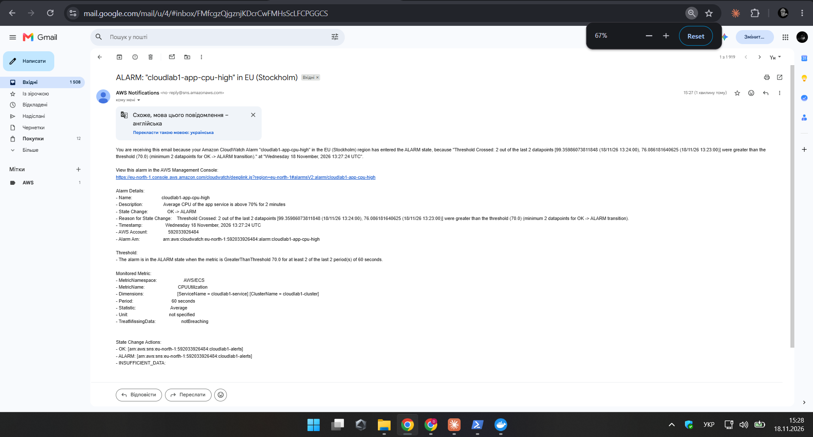
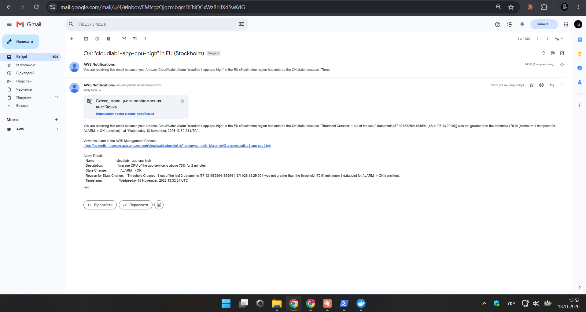

# Сповіщення (завдання 4)

## Умова

**Середнє завантаження процесора сервісу понад 70 % протягом 2 хвилин** (2 з 2 хвилинних точок).

| Що | Значення | Де в Terraform |
|---|---|---|
| Правило | `aws_cloudwatch_metric_alarm.app_cpu_high` | [`terraform/monitoring.tf`](../terraform/monitoring.tf) |
| Метрика | `AWS/ECS` → `CPUUtilization`, `ClusterName` + `ServiceName`, Average | |
| Період × кількість | 60 с × 2 (`period`, `evaluation_periods`, `datapoints_to_alarm`) | |
| Поріг | `> 70` (`var.cpu_alarm_threshold`) | |
| Лист «проблема» | `alarm_actions` → SNS | |
| Лист «норма» | `ok_actions` → SNS | |
| Канал доставки | `aws_sns_topic.alerts` + `aws_sns_topic_subscription.email` (протокол `email`) | |

Після першого `terraform apply` AWS надсилає лист **«AWS Notification — Subscription Confirmation»**. Без натискання **Confirm subscription** листи не доставлятимуться.

Додатково (ті самі листи, корисні для захисту): `cloudlab1-app-at-max-capacity` (сервіс досяг максимуму 4 задач), `cloudlab1-app-5xx` і `cloudlab1-no-healthy-targets` (з Лаби 1).

### Чому саме ця умова

- **CPU — та сама метрика, за якою масштабуємо.** Ціль масштабування 60 %, поріг алерту 70 %. Поки масштабування встигає, CPU тримається біля 60 % і листів немає. Лист означає, що навантаження росте швидше, ніж додаються задачі, або вже досягнуто максимуму. Тобто він сигналізує про ситуацію, де може знадобитися людина.
- **«Протягом 2 хвилин», а не одна точка.** Один хвилинний сплеск (наприклад, старт задачі, коли Python завантажує модулі) не повинен будити людину. Дві хвилини поспіль — це вже тенденція. Такий фільтр захищає від flapping, коли алерт перемикається туди-сюди на кожному коливанні.
- **Лист і при поверненні до норми** (`ok_actions`): людина дізнається, що проблема минула сама, і може не втручатися.

Альтернатива, яка краще описує досвід користувача: p95 латентності > 500 мс протягом 2 хв.

## Прогін

> ⏳ **Заповнити після прогону** (`.\loadtest\run.ps1 -Label baseline`). Знімки листів покласти в `docs/img/`.

| Подія | Час (місцевий) |
|---|---|
| Початок сталого навантаження (кінець фази наростання, +3 хв від старту k6) | ⏳ |
| CPU уперше > 70 % (графік 2 на панелі) | ⏳ |
| Стан алерту → `ALARM` (CloudWatch → Alarms → History) | ⏳ |
| Лист «ALARM» прийшов у пошту | ⏳ |
| Стан алерту → `OK` | ⏳ |
| Лист «OK» прийшов у пошту | ⏳ |

**Час від початку сталого навантаження до першого листа: ⏳ хв.**

## З чого складається затримка

Час до першого листа (типово 3–5 хв від моменту, коли CPU перетнув 70 %):

1. **Агрегація метрики, ~1 хв.** CPU рахується за хвилину і з'являється в CloudWatch після її завершення (плюс до хвилини затримки публікації).
2. **Вікно оцінки, 2 хв.** Потрібні 2 точки поспіль понад 70 %.
3. **Обчислення алерту, до 1 хв.** CloudWatch перевіряє алерти раз на період.
4. **Доставка SNS → email, секунди–хвилина.**

Плюс фаза наростання: CPU зазвичай перетинає 70 % ближче до кінця наростання або на початку сталої фази.

## Чи прийнятний такий час реакції

- **Для навчального або внутрішнього сервісу — так.** 3–5 хвилин значно менше, ніж людина реагує на лист (відкрити пошту, ноутбук, консоль). Головну роботу тут робить автомасштабування, яке спрацьовує раніше. Лист потрібен для випадків, коли воно не справляється.
- **Для реального сервісу з користувачами — на межі.** За 5 хвилин деградації частина користувачів уже отримає повільні відповіді. У продакшні додали б:
  - алерт на латентність або частку помилок (симптоми, які бачить користувач), а не лише на CPU (причина);
  - метрики з високою роздільністю (10 с) і коротші вікна для критичних сигналів;
  - канал, що будить людину (PagerDuty/Opsgenie, SMS), замість пошти;
  - окремий алерт «досягнуто максимуму задач» (є: `cloudlab1-app-at-max-capacity`): саме тоді автомасштабування більше не допоможе.
