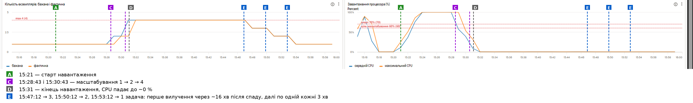

# Автоматичне масштабування (завдання 1 і 3)

## Політика масштабування

Описана в [`terraform/autoscaling.tf`](../terraform/autoscaling.tf), змінні — у [`terraform/variables.tf`](../terraform/variables.tf).

| Параметр | Значення | Де в Terraform |
|---|---|---|
| Тип політики | Target tracking (`TargetTrackingScaling`) | `aws_appautoscaling_policy.app_cpu` |
| Метрика | `ECSServiceAverageCPUUtilization`: середній CPU усіх задач сервісу | `predefined_metric_specification` |
| Цільове значення | **60 %** | `var.cpu_target_percent` |
| Мінімум екземплярів | **1** | `var.app_min_tasks` → `aws_appautoscaling_target.app` |
| Максимум екземплярів | **4** (валідація не дасть поставити більше) | `var.app_max_tasks` |
| Cooldown на додавання | **60 с** | `var.scale_out_cooldown` |
| Cooldown на вилучення | **120 с** | `var.scale_in_cooldown` |
| Розмір задачі | 0.25 vCPU / 512 MB (Fargate) | `aws_ecs_task_definition.app` |

`desired_count` сервісу Terraform не чіпає (`ignore_changes = [task_definition, desired_count]` в `ecs.tf`), бо кількістю задач керує Application Auto Scaling, а версією образу — CI/CD.

### Чому ціль саме 60 %

- **Запас на час реакції.** Від перетину порогу до моменту, коли новий екземпляр приймає трафік, минає 3–5 хвилин (розбір нижче). Увесь цей час навантаження тримають наявні задачі. Ціль 60 % лишає ~40 % запасу на ріст трафіку, поки нові задачі стартують.
- **Задачі маленькі.** 0.25 vCPU — це чверть ядра. Python-процес uvicorn на такій задачі вже після ~80 % CPU починає накопичувати чергу запитів, і p95 латентності різко росте. 60 % тримає нас у зоні, де латентність ще стабільна.
- **Не надто низько.** При цілі 30–40 % сервіс постійно тримав би зайві задачі, тобто платив би за простій. 60–70 % — звичайний компроміс між вартістю і запасом.
- **Узгоджено з алертом.** Лист приходить при CPU > 70 % протягом 2 хвилин ([ALERTS.md](ALERTS.md)). Тобто масштабування починає працювати раніше, ніж людину будять листом. Лист означає, що масштабування не встигає.

### Що таке період стабілізації (cooldown)

Cooldown — це пауза після дії масштабування, коли політика не робить наступного кроку в той самий бік. Вона чекає, поки результат попереднього кроку проявиться в метриці.

- **Scale-out cooldown (60 с).** Нова задача стартує 1–2 хвилини, і поки вона не прийняла трафік, середній CPU не падає. Без паузи політика бачила б «CPU все ще високий» і додавала б ще задачі, хоча допомога вже в дорозі. Для target tracking в ECS це працює так: протягом cooldown уже замовлена ємність враховується як наявна, тож нова задача додається лише тоді, коли потрібно більше, ніж уже замовлено.
- **Scale-in cooldown (120 с).** Після вилучення задачі навантаження перерозподіляється між рештою, і CPU на них росте. Пауза дає це побачити, перш ніж прибирати наступну.

### Що станеться, якщо cooldown = 0

- **Перемасштабування (overshoot).** На старті навантаження політика кожну хвилину бачить високий CPU (нові задачі ще не готові) і додає задачі, доки не впреться в максимум 4, хоча вистачило б 2. Ми платимо за зайві задачі.
- **Коливання (flapping, «пилка»).** Після спаду задачі прибираються одна за одною без паузи. Решта перевантажується, CPU стрибає вгору, задачі знову додаються. Кількість екземплярів «пиляє» вгору-вниз.
- **Гірший досвід користувачів.** Кожне вилучення — це перервані з'єднання (якби не було graceful shutdown) і холодні старти нових задач. Часті цикли додавання й вилучення погіршують p95/p99.

Що окремо від cooldown: AWS для target tracking сам створює два CloudWatch-алерти. **AlarmHigh** спрацьовує після 3 хвилин вище цілі, **AlarmLow** — після 15 хвилин нижче ~90 % цілі. Тому навіть з cooldown = 0 масштабування не реагує миттєво. Ця асиметрія свідома: додавати швидко, прибирати обережно.

## Панель моніторингу

Описана в [`terraform/monitoring.tf`](../terraform/monitoring.tf) (`aws_cloudwatch_dashboard.main`), адреса — `terraform output dashboard_url`. Для графіків кількості екземплярів на кластері ввімкнено Container Insights (`setting { name = "containerInsights" }` в `ecs.tf`).

| № | Графік | Метрика |
|---|---|---|
| 1 | Кількість екземплярів: бажана і фактична | `ECS/ContainerInsights` → `DesiredTaskCount`, `RunningTaskCount` |
| 2 | Завантаження процесора + лінії 60 % (ціль) і 70 % (алерт) | `AWS/ECS` → `CPUUtilization` |
| 3 | Запити за хвилину | `AWS/ApplicationELB` → `RequestCount` (Sum, 60 с) |
| 4 | Латентність p95 (+ p50, лінія 500 мс) | `AWS/ApplicationELB` → `TargetResponseTime` (p95) |
| 5 | Відповіді 5xx | `HTTPCode_Target_5XX_Count`, `HTTPCode_ELB_5XX_Count` |
| + | Кеш: влучання, промахи, запити до БД, % влучань | власні метрики `CloudLab1/App` (EMF з логів застосунку) |
| + | Навантаження на БД | `AWS/RDS` → `CPUUtilization`, `DatabaseConnections` |
| + | Стан алертів | 4 алерти з `monitoring.tf` |
| + | Черга і воркери (бонус 6) | `AWS/SQS` + `ECS/ContainerInsights` для `cloudlab1-worker` |

## Прогін: знімки панелі

Прогін `baseline` 18.11.2026: `.\loadtest\run.ps1 -Label baseline -Vus 80` (80 віртуальних користувачів, 3 хв наростання, 5 хв стало, 2 хв спад; результати — у [LOADTEST.md](LOADTEST.md)). Час — київський. Точні часи рішень масштабування взято з `aws application-autoscaling describe-scaling-activities`, алерту — з `aws cloudwatch describe-alarm-history`.

| Момент | Час | Що видно на панелі |
|---|---|---|
| A. Початок навантаження | 15:21:05 | графік 3 (запити) починає рости |
| B. Перетин порогу 60 % | ~15:23 | графік 2: CPU 76 % (хвилина 15:23), 99 % (15:24) — і ціль 60 %, і поріг алерту 70 % перетнуто майже одночасно |
| C. Поява нового екземпляра | рішення 15:28:43 (1 → 2) і 15:30:43 (2 → 4); задачі працюють з ~15:30 і ~15:32 | графік 1: спершу росте «бажана», через 1–1.5 хв — «фактична» |
| D. Кінець навантаження | 15:31:15 | графік 3 падає до нуля, CPU — до ~0 % |
| E. Вилучення екземплярів | 15:47:12 (4 → 3), 15:50:12 (→ 2), 15:53:12 (→ 1) | графік 1 сходинками повертається до 1 |

Масштабування дійшло до максимуму 4: на 2 задачах CPU все ще був ~100 %, і target tracking розрахував потрібну кількість як `2 × 100 % / 60 % ≈ 3.3 → 4`. Після цього CPU упав нижче цілі, і лист «OK» прийшов о 15:32:24, ще до кінця тесту.

Два ранні піки CPU о 15:08 і 15:15 — пробні 2-хвилинні прогони `calibrate` для підбору N ([LOADTEST.md](LOADTEST.md)), вони занадто короткі, щоб запустити масштабування.

## Чому екземпляр з'являється не одразу після перетину порогу

Затримка B → C складається з кількох етапів:

1. **Збір метрики (~1 хв).** ECS публікує `CPUUtilization` раз на хвилину, тому висока хвилина стає видимою лише після завершення.
2. **Алерт target tracking (~3 хв).** Внутрішній AlarmHigh спрацьовує лише після **3 послідовних** хвилин вище цілі. Один короткий сплеск не повинен додавати задачу.
3. **Рішення і запуск задачі (10–30 с).** Application Auto Scaling змінює `desired`, ECS ставить задачу в чергу на Fargate.
4. **Старт задачі (~40–90 с).** Виділення ресурсів Fargate, завантаження образу з ECR, старт контейнера, відкриття пулу з'єднань до БД.
5. **Health check балансувальника (~30 с).** Задача отримує трафік лише після 2 успішних перевірок `/health` з інтервалом 15 с (`alb.tf`).

Разом це **~4–6 хвилин** від перетину порогу до допомоги. Тому ціль і стоїть на 60 %, а не на 90 %.

**Виміряно в прогоні:** CPU перетнув 60 % близько 15:23, рішення додати задачу — 15:28:43 (**~5.5 хв**), нова задача почала приймати трафік близько 15:30 (**~7 хв**). Найбільшу частину зайняли пп. 1–2: три хвилинні точки вище цілі (15:23, 15:24, 15:25) стали доступні в CloudWatch лише через 1–2 хв після кінця кожної хвилини. Увесь цей час навантаження тримала одна задача з CPU ~100 %, через що p95 прогону (281 мс) значно вищий, ніж у пробному прогоні на 60 користувачах без перевантаження (40 мс).

## Чому вилучення відбувається значно пізніше за падіння навантаження

1. **AlarmLow чекає 15 хвилин.** Target tracking прибирає задачі, лише коли CPU **15 хвилин поспіль** нижче ~90 % цілі. Навантаження після тесту могло тимчасово впасти, і передчасне вилучення означало б нове додавання через 5 хвилин.
2. **Вилучення поступове.** Задачі прибираються по одній із scale-in cooldown 120 с між кроками.
3. **Коректне завершення.** Задача спершу знімається з балансувальника (deregistration delay 15 с, нові запити йдуть на інші задачі), потім отримує SIGTERM. Uvicorn дообробляє поточні запити (до 20 с, `--timeout-graceful-shutdown 20` у `Dockerfile`), і лише потім контейнер зупиняється (`stopTimeout = 30`).

**Виміряно в прогоні:** навантаження закінчилось о 15:31, перше вилучення — о 15:47:12 (**~16 хв**: 15 хвилинних точок AlarmLow + затримка метрик), далі по одній задачі кожні **3 хв** (scale-in cooldown 120 с + хвилина на нову точку метрики), до 1 задачі — о 15:53:12, тобто **~22 хв** після спаду.

Асиметрія навмисна: недостатня ємність коштує помилок і повільних відповідей користувачам, а зайва — лише трохи грошей.

> ⚠️ Після кожного тесту дочекатися, поки графік 1 повернеться до **1** (~20–25 хвилин після спаду), або перевірити командою:
> `aws ecs describe-services --cluster cloudlab1-cluster --services cloudlab1-service --query "services[0].[desiredCount,runningCount]"`
