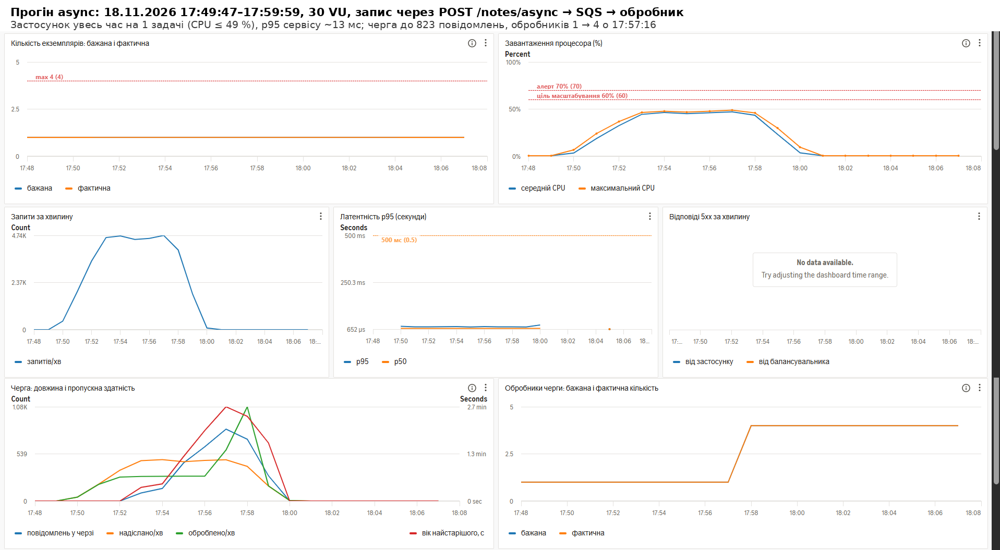

# Асинхронна обробка через чергу (бонус 6)

## Що зроблено

| Частина | Де |
|---|---|
| Черга Amazon SQS `cloudlab1-jobs` + dead-letter queue `cloudlab1-jobs-dlq` (після 5 невдалих спроб) | [`terraform/queue.tf`](../terraform/queue.tf) |
| Ендпоінт `POST /notes/async`: кладе повідомлення в чергу, відповідає **`202 Accepted`** | [`app/main.py`](../app/main.py) |
| Ендпоінт `GET /jobs/{job_id}`: статус задачі | [`app/main.py`](../app/main.py) |
| Окремий контейнер-обробник `worker.py`, сервіс ECS `cloudlab1-worker` | [`app/worker.py`](../app/worker.py), [`terraform/ecs.tf`](../terraform/ecs.tf) |
| Масштабування обробника від довжини черги: 1–4 задачі, ціль — 20 повідомлень на воркер | `aws_appautoscaling_policy.worker_backlog` у [`terraform/autoscaling.tf`](../terraform/autoscaling.tf) |
| Права: застосунок може лише `SendMessage`, воркер — лише читати/видаляти | [`terraform/iam.tf`](../terraform/iam.tf) |
| Графіки «Queue» і «Queue workers» | [`terraform/monitoring.tf`](../terraform/monitoring.tf) |

Обробник імітує тривалу операцію (`WORK_DELAY_MS = 200` мс на повідомлення) і обробляє повідомлення послідовно, тому одна задача встигає ~5 повідомлень/с. Цього мало для 60 користувачів, тож черга росте і видно масштабування воркерів.

Масштабування воркерів рахує метрику «повідомлень на одного воркера» через metric math: `ApproximateNumberOfMessagesVisible / RunningTaskCount`. Target tracking тримає її біля 20, тобто додає воркерів, поки черга не почне спадати. Так рекомендує AWS: ціль «backlog per task», а не абсолютна довжина черги.

## Прогін

```powershell
.\loadtest\run.ps1 -Label async -Mode async -Vus 30
```

18.11.2026 17:49:47–17:59:59 (Київ), той самий сценарій «1 запис + 9 читань», але запис іде через `POST /notes/async`. Звіт k6 — [`loadtest/results/async.md`](../loadtest/results/async.md). Латентність сервісу — `TargetResponseTime` балансувальника (p95 за час прогону), решта — з CloudWatch і `describe-scaling-activities`.



| Показник | Синхронний запис, 80 VU (`baseline`) | Через чергу, 30 VU (`async`) |
|---|---|---|
| p95 сервісу (балансувальник, `TargetResponseTime`) | 188 мс | **13.4 мс** |
| CPU застосунку, максимум | ~100 % | **48.9 %** |
| Екземплярів застосунку | 1 → 4 | **1** увесь прогін |
| Максимум повідомлень у черзі | — | **823** |
| Найстаріше повідомлення в черзі, максимум | — | ~2.7 хв |
| Обробників черги | 1 | **1 → 4** (рішення о 17:57:16) |
| Помилки | 0.01 % | 0.00 % |

Що видно на панелі:

- **Латентність сервісу не росте.** `POST /notes/async` лише перевіряє токен, записує статус у Redis і кладе повідомлення в SQS; повільну роботу (запис у БД + імітація 200 мс) робить обробник. Графік «Латентність p95» увесь прогін лежить на рівні ~10 мс, застосунок лишається на одній задачі з CPU < 50 %.
- **Обробник масштабується від довжини черги.** Один обробник встигає ~5 повідомлень/с, а 30 користувачів дають ~8–9 записів/с, тож черга росла (до 823 повідомлень). Коли «повідомлень на одного обробника» стало значно більше за ціль 20, target tracking одразу поставив максимум 4 (17:57:16). Після цього швидкість обробки («оброблено/хв») стрибнула, і черга спорожніла за ~2 хв.
- **Обробник реагує із затримкою ~5 хв** від початку росту черги: метрики SQS приходять у CloudWatch із запізненням, і target tracking чекає кілька точок вище цілі (як і для CPU, [AUTOSCALING.md](AUTOSCALING.md)). Для запису через чергу це не страшно: клієнт уже отримав `202`, а затримка обробки видна лише як «вік найстарішого повідомлення».
- **Вилучення обробників** — так само повільне, як для застосунку: через ~15 хв після спорожніння черги, по одному.

Перша спроба з 80 VU (як `baseline`) показала, що черга не рятує від перевантаження **читаннями**: 9 запитів із 10 у сценарії — це читання, і їх обробляє застосунок, тому на 80 VU він знову вперся в CPU, хоча записи вже йшли через чергу (обробники тоді теж масштабувались 1 → 4). Тому для демонстрації черги взято навантаження, яке застосунок тримає без масштабування, а обробник — ні.

## Що змінилося для клієнта

| | `POST /notes` (синхронно) | `POST /notes/async` |
|---|---|---|
| Код | `201 Created` | `202 Accepted` |
| Тіло | готовий пост з `id` | `{"job_id": "...", "status": "queued", "status_url": "/jobs/..."}` |
| Заголовок | — | `Location: /jobs/<job_id>` |
| Гарантія | пост уже в базі | запит **прийнято**, пост з'явиться пізніше |

`201` означає «зроблено», а `202` — «прийнято до виконання». Клієнт не може одразу показати `id` поста і має бути готовий, що операція ще не завершилась (або завершиться з помилкою).

## Як клієнт дізнається результат

**Опитування (polling)** `GET /jobs/{job_id}` з тим самим JWT (чужу задачу не видно, буде 404):

```json
{"job_id": "…", "status": "queued", "owner_id": 7}
{"job_id": "…", "status": "done", "owner_id": 7, "note": {"id": 123, "title": "…"}, "duplicate": false}
```

Статус зберігається в Redis 24 години. Альтернативи в реальних системах: webhook (сервер сам викликає URL клієнта), WebSocket/SSE (сервер пушить подію), або подія в іншу чергу/топік.

## Доставка «щонайменше один раз» (at-least-once)

SQS гарантує, що повідомлення **не загубиться**, але **може бути доставлене більше одного разу**:

- воркер отримав повідомлення, і воно стало невидимим на `visibility_timeout` (30 с);
- якщо воркер упав, завис або не встиг видалити повідомлення до кінця таймауту, SQS знову робить його видимим і віддає іншому воркеру;
- навіть без збоїв стандартна черга SQS зрідка доставляє дублікат (розподілене сховище).

Протилежність — «щонайбільше один раз» (at-most-once): видалити повідомлення одразу при отриманні. Тоді дублікатів немає, але збій посередині обробки означає втрачену операцію. Черги обирають at-least-once, бо дублікат можна безпечно відкинути на стороні обробника, а втрачене повідомлення вже не повернеш.

## Що буде при повторній обробці повідомлення

Обробка **ідемпотентна** ([`app/worker.py`](../app/worker.py)):

- `job_id` з повідомлення записується в колонку `notes.request_id` з обмеженням `UNIQUE`;
- вставка — `INSERT ... ON CONFLICT (request_id) DO NOTHING RETURNING ...`;
- якщо повідомлення прийшло вдруге, вставка нічого не робить, воркер читає вже створений пост, ставить статус `done` з `"duplicate": true` і видаляє повідомлення. Другого поста в базі **не з'являється**;
- лічильник `JobsDuplicate` на панелі показує, скільки дублікатів відкинуто.

Перевірено локально: повідомлення з тим самим `job_id`, відправлене вручну вдруге, дало `duplicate=True`, і пост лишився один.

Повідомлення, яке падає 5 разів поспіль (наприклад, битий JSON), переїжджає в `cloudlab1-jobs-dlq` і не блокує чергу.
