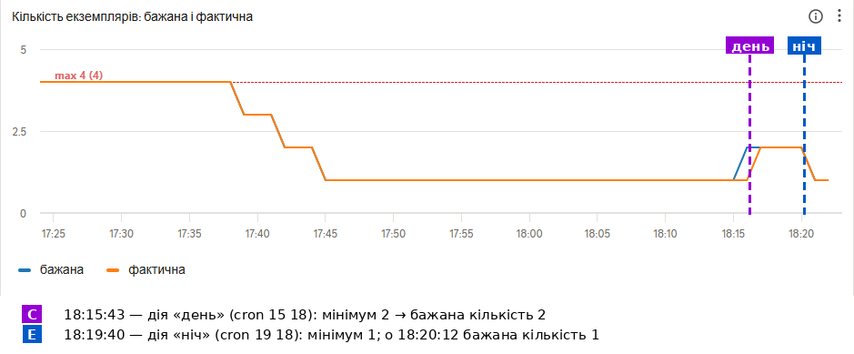

# Масштабування за розкладом (бонус 8)

## Що зроблено

Два `aws_appautoscaling_scheduled_action` у [`terraform/autoscaling.tf`](../terraform/autoscaling.tf) змінюють **мінімальну** кількість задач застосунку. Максимум 4 і політика за CPU працюють поверх розкладу.

| Дія | Коли (Europe/Kiev) | min | max |
|---|---|---|---|
| `cloudlab1-app-day` | щодня о 08:00 (`cron(0 8 * * ? *)`) | **2** | 4 |
| `cloudlab1-app-night` | щодня о 23:00 (`cron(0 23 * * ? *)`) | **1** | 4 |

Розклад вмикається змінною `enable_schedule` (за замовчуванням `false`). Так денний мінімум 2 не заважає демонструвати масштабування 1 → N у завданнях 1–3.

```powershell
cd D:\univer\Cloud_Technologies\Lab1\terraform
terraform apply -var="enable_schedule=true"
aws application-autoscaling describe-scheduled-actions --service-namespace ecs --query "ScheduledActions[].[ScheduledActionName,Schedule,Timezone,ScalableTargetAction]"
```

### Перевірка (18.11.2026)

Щоб не чекати до 08:00 і 23:00, розклад увімкнули з тестовим часом — «день» через 3 хв, «ніч» через 7 хв:

```powershell
$day = (Get-Date).AddMinutes(3); $night = (Get-Date).AddMinutes(7)
terraform apply -var="enable_schedule=true" -var="day_start_cron=cron($($day.Minute) $($day.Hour) * * ? *)" -var="night_start_cron=cron($($night.Minute) $($night.Hour) * * ? *)"
```

`terraform plan` — `2 to add` (лише дві дії розкладу), `describe-scheduled-actions`:

```
|  cloudlab1-app-day   |  cron(15 18 * * ? *)  |  Europe/Kiev |
|  cloudlab1-app-night |  cron(19 18 * * ? *)  |  Europe/Kiev |
```

Історія масштабування (`aws application-autoscaling describe-scaling-activities`):

| Час | Подія |
|---|---|
| 18:15:43 | дія «день»: мінімум 2 → `Setting desired count to 2` |
| 18:19:40 | дія «ніч»: `Setting min capacity to 1 and max capacity to 4` |
| 18:20:12 | `Setting desired count to 1` |

Друга задача з'явилася одразу після дії «день» (без навантаження — лише через новий мінімум). Після дії «ніч» вона зникла вже за 32 с: CPU весь цей час був ~0 %, тож внутрішній алерт вилучення target tracking уже перебував у стані ALARM і чекав лише, поки мінімум дозволить зменшити кількість.



Ліва частина графіка (17:38–17:45) — вилучення задач після попереднього навантажувального прогону, до розкладу не належить.

### Чому вночі 1, а не 0

ECS дозволяє `desiredCount = 0`, але для веб-API за балансувальником це погано:
- без задач немає CPU-метрики, тож target tracking **не може** сам піднятися з нуля, коли прийдуть запити;
- балансувальник без здорових цілей відповідає `503`, тобто нічний користувач отримає помилку, а не повільну відповідь;
- холодний старт задачі Fargate (виділення ресурсів, завантаження образу, старт Python, health check) займає ~1–2 хвилини, а не секунди, як у Cloud Run чи Lambda.

Тому мінімум уночі — 1 задача. Масштабування до нуля має сенс для сервісів, які вміють будитися запитом (Cloud Run, Azure Container Apps, Lambda) або для воркерів черги (там можна масштабуватися від довжини черги з 0).

## Розрахунок місячної економії

Ціна Fargate Linux/x86 за [офіційною сторінкою](https://aws.amazon.com/fargate/pricing/) (US East): **$0.04048 за vCPU-год** і **$0.004445 за GB-год**. У `eu-north-1` ціни відрізняються на кілька відсотків, тож порядок той самий.

Одна задача застосунку (0.25 vCPU, 0.5 GB):

```
0.25 × 0.04048 + 0.5 × 0.004445 = 0.01012 + 0.0022225 = $0.0123425 за годину
```

День 08:00–23:00 = 15 год, ніч 23:00–08:00 = 9 год, місяць = 30 днів.

| Варіант | Задач·год на добу | Задач·год на місяць | Вартість на місяць |
|---|---|---|---|
| Без розкладу, 2 задачі цілодобово (щоб удень був запас) | 2 × 24 = 48 | 1 440 | **$17.77** |
| **Розклад: удень 2, уночі 1** | 2 × 15 + 1 × 9 = 39 | 1 170 | **$14.44** |
| Для порівняння: удень 2, уночі 0 | 2 × 15 = 30 | 900 | $11.11 |

**Економія розкладу 2/1: 270 задач·год = $3.33 на місяць (−18.75 %)** відносно цілодобових 2 задач. Варіант 2/0 зекономив би $6.67 (−37.5 %), але ціною `503` уночі (див. вище).

Масштабування за CPU додає задачі поверх мінімуму лише під час піків. Їхня вартість однакова в усіх варіантах і в розрахунок не входить.

Абсолютні суми маленькі, бо задача крихітна. Але відносна економія та сама для будь-якого розміру: для сервісу з 20 задачами по 1 vCPU / 2 GB ті самі 18.75 % — це вже сотні доларів на місяць.
